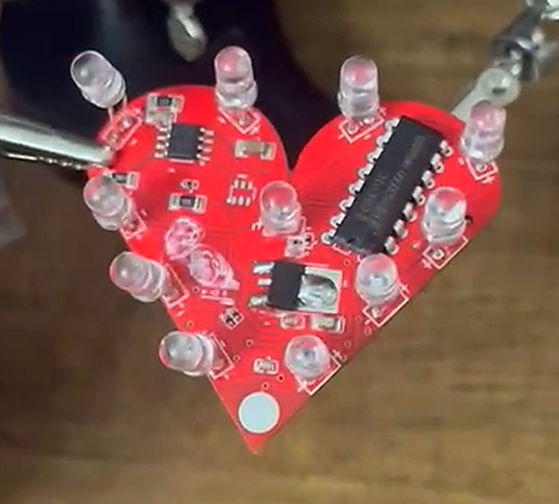
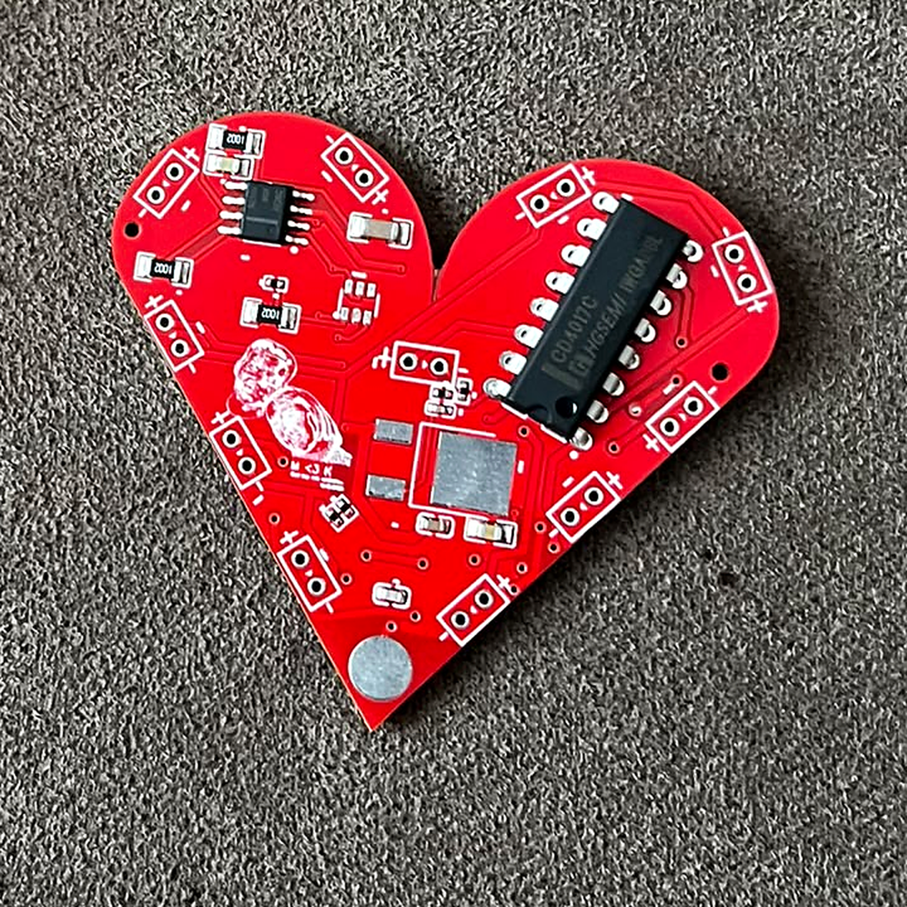
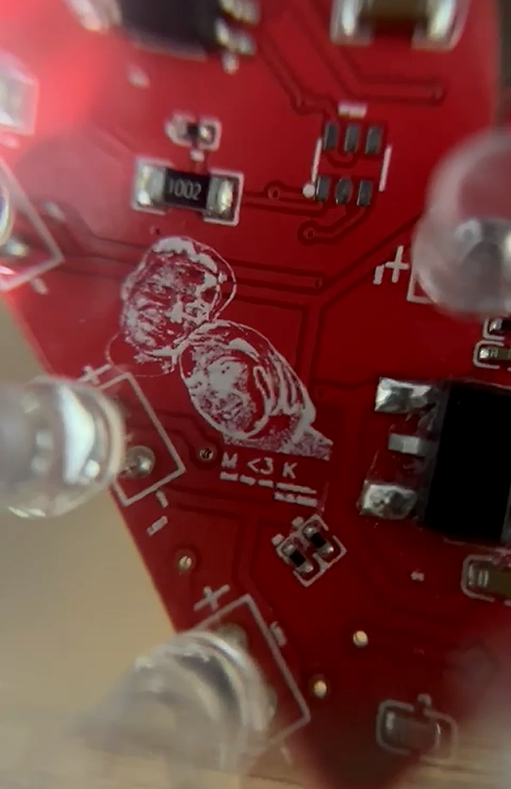
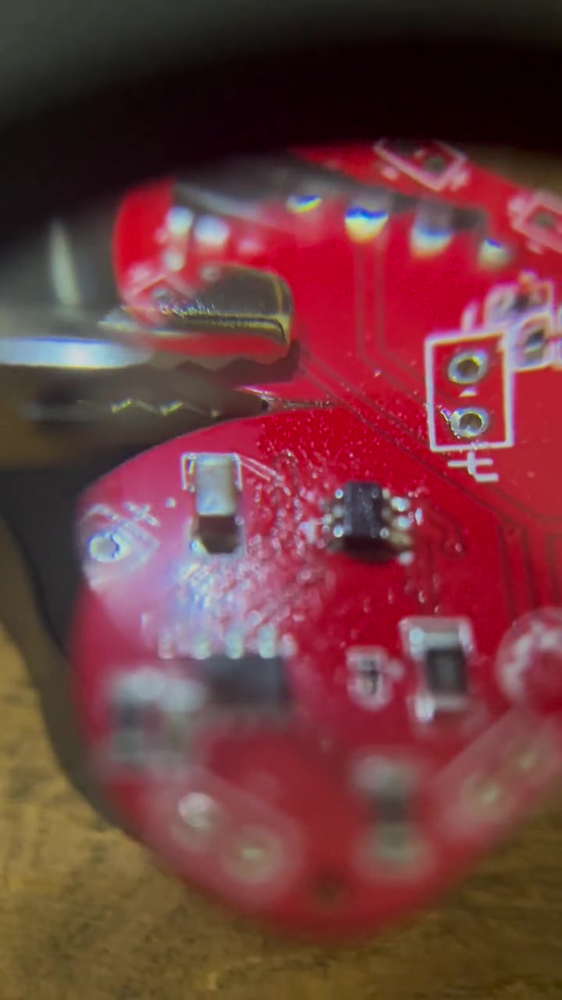
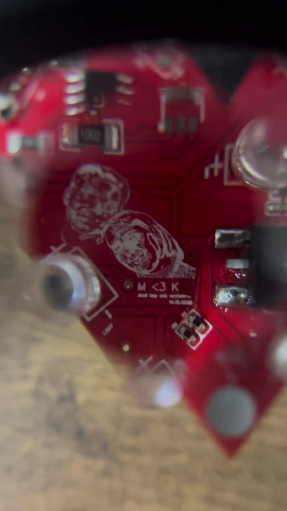
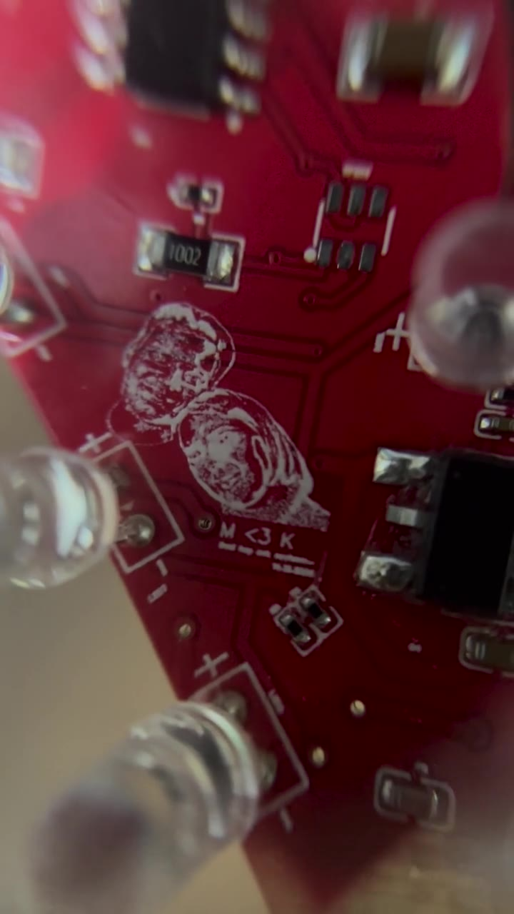

# Valentines day PCB

Dokunmatik kontrollü, kalp biçimli LED kartı. EasyEDA Standard ile Ocak–Şubat 2025 döneminde tasarladığım ve JLCPCB üzerinden ürettirdiğim kişisel elektronik projem.

## Çerçeveli çalışma

[Tam kadrajlı çalışma videosunu aç](framed-demo.mp4) · [Portfolyoda oynat](https://korayakdogan.me/#pcb-medya)

Video, çerçevenin tamamını ve çalışan LED kartını birlikte gösterir. Görüntü kırpılmamıştır; yayımlanan kopya sessizdir.

LED’lerin sırayla yanışını yakından izlemek için aynı kaydın karta odaklanan kesiti: [LED sırası videosu](led-sequence.mp4).

## Proje fotoğrafları

### Kartın ilk hâli

### PCB üzerindeki fotoğraf işlemesi

Fotoğraflarda klasik kırpma, ışık, kontrast ve hafif keskinlik düzenlemesi uygulanmıştır; üretken yapay zekâ ile ayrıntı eklenmemiştir. Teknik parça ve bağlantı bilgileri için düzenlenebilir şema ve PCB kaynakları kullanılmalıdır.

[EasyEDA üst katman yerleşimini aç](pcb-layout.png)

## Montaj ve kontrol

Şubat 2025’te, kartları dizip lehimlediğim sırada çektiğim görüntüler.

<table>
  <tr>
    <td width="50%"></td>
    <td width="50%"></td>
  </tr>
  <tr>
    <td>LED’ler takılmadan önce, SMD parçaları lehimlenmiş kart</td>
    <td>Büyüteç altında TTP223 dokunmatik sensörü ve çevresi</td>
  </tr>
</table>

### Videolar

Kapak görseline tıklayınca video açılır. Tüm videolar sessizdir.

<table>
  <tr>
    <td width="25%"></td>
    <td width="25%"></td>
    <td width="25%"></td>
    <td width="25%"></td>
  </tr>
  <tr>
    <td>SMD lehim kontrolü · 4 sn</td>
    <td>Montajı biten kart · 7 sn</td>
    <td>Büyüteçle kontrol · 16 sn</td>
    <td>İşleme ve LED’ler yakın plan · 10 sn</td>
  </tr>
</table>

Videolar telefonun HDR kayıtlarından SDR’ye dönüştürülüp 720 × 1280 çözünürlüğe ölçeklendi. Yalnızca baştaki ve sondaki konu dışı kısımlar kesildi; görüntüye ekleme yapılmadı.

## Devre yapısı

Kartta TTP223-BA6 kapasitif dokunmatik sensörü, NE555 zamanlayıcısı, CD4017CN sayacı ve 7805 regülatörü bulunuyor. Mikrodenetleyici veya firmware kullanmıyor.

- **Besleme:** Pil girişi `+BATT` hattına, 7805 çıkışı `VCC` hattına bağlı. Projede 9 V pil ve 5 V regülasyon kullandım.
- **Dokunmatik kontrol:** TTP223’ün 1 numaralı çıkışı ile NE555’in 4 numaralı RESET girişi aynı `I/O` hattında. Dokunma elektrodu `TP` hattına bağlı.
- **Zamanlama ve LED sıralaması:** NE555’in 3 numaralı çıkışı, CD4017’nin 14 numaralı saat girişine `555-3` hattıyla bağlı. CD4017’nin on sayma çıkışı LED1–LED10’a gidiyor. `555L` adlı ayrı bir LED de zamanlayıcı çıkışına bağlı.

Bu bağlantılar depodaki PCB kaynağından okunabilir. Bileşenlerin pin işlevleri için [NE555](https://www.ti.com/product/NE555), [CD4017B](https://www.ti.com/product/CD4017B) ve [Tontek dokunmatik sensör ailesi](https://www.tontek.com.tw/product/product2?idx=243&lang=) üretici kaynaklarına bakılabilir; BOM’daki üretici ve parça kodları ayrıca dikkate alınmalıdır.

## Tasarımda kullanılan bileşenler

| Grup | Adet | Şemadaki tanım |
| --- | ---: | --- |
| Dokunmatik sensör | 1 | TTP223-BA6, SOT-23-6 |
| Zamanlayıcı | 1 | NE555, SOIC-8 |
| Sayaç | 1 | CD4017CN, PDIP-16 |
| Regülatör | 1 | 7805, TO-252 |
| LED | 11 | LED1–LED10 ve 555L |
| Direnç | 8 | 3 × 10 kΩ, 4 × 330 Ω, 1 × 120 Ω |
| Kondansatör | 6 | 10 µF, 10 nF, 330 nF, 30 pF, 2 × 100 nF |

[bom.csv](bom.csv), şemadaki 29 bileşeni referans kodları, değerleri, kılıfları ve tedarikçi kodlarıyla listeler. Bu liste tasarım BOM’udur. Montajda kullanılan muadil parçaları tanımlayan bir liste değildir: örneğin tedarik geçmişindeki LM7805MP/NOPB ile tasarımın TO-252 7805 ayak izi aynı kılıf bilgisine sahip değildir.

## Dosyalar

| Dosya | İçerik |
| --- | --- |
| [schematic.json](schematic.json) | EasyEDA Standard şema projesi, `Sheet_1` |
| [pcb.json](pcb.json) | Düzenlenebilir PCB yerleşimi |
| [bom.csv](bom.csv) | Şemadan çıkarılmış tasarım BOM’u |
| [pcb-layout.png](pcb-layout.png) | Üst katman, baskı ve kart sınırı görünümü |

JSON dosyaları EasyEDA Standard’ın **Dosya → Aç → EasyEDA** akışıyla açılabilir. Arayüz diline göre menü adları değişebilir. Düzenleme ve yeniden üretim için kaynak dosyaları kullanın; PNG üretim dosyası değildir.

## Proje geçmişi

Şema antetinde 31 Ocak 2025 tarihi ve 1.0 revizyonu bulunuyor. İlk üretimde 5 PCB sipariş ettim; kartları Şubat 2025’te elle dizip lehimledim.

Buradaki dosyalar EasyEDA hesabımdaki mevcut tasarımın 16 Ekim 2026 tarihli dışa aktarımıdır. İlk üretime gönderilen Gerber arşivinin birebir kopyası olarak sunulmamaktadır.

## Kapsam

Bu depo, kişisel projenin tasarım arşividir. Yeniden üretim öncesinde seçilen parçaların ayak izleri, LED akımı, besleme ve tasarım kuralları kontrol edilmelidir.

**Tasarım:** Koray Akdoğan · [Portfolyo](https://korayakdogan.me/) · [GitHub](https://github.com/Omrndr)
