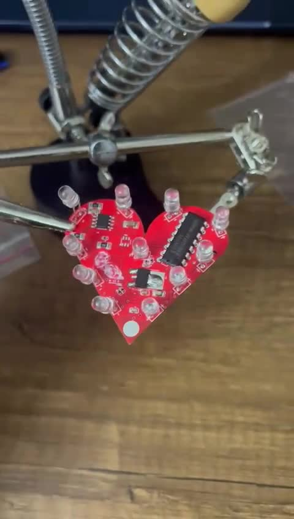
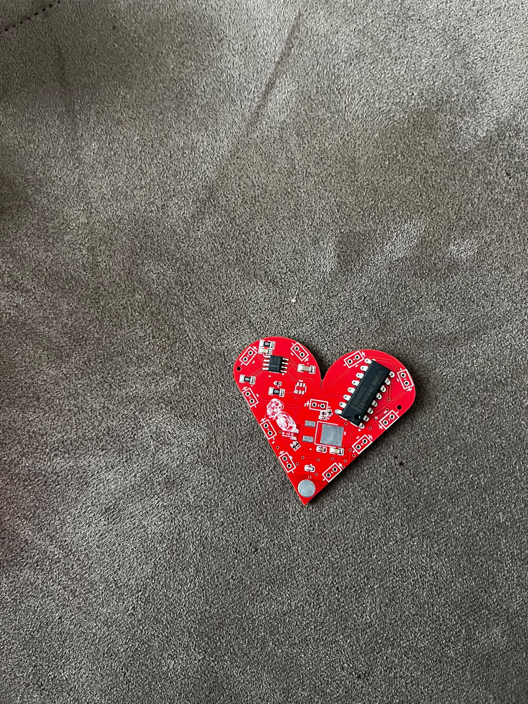
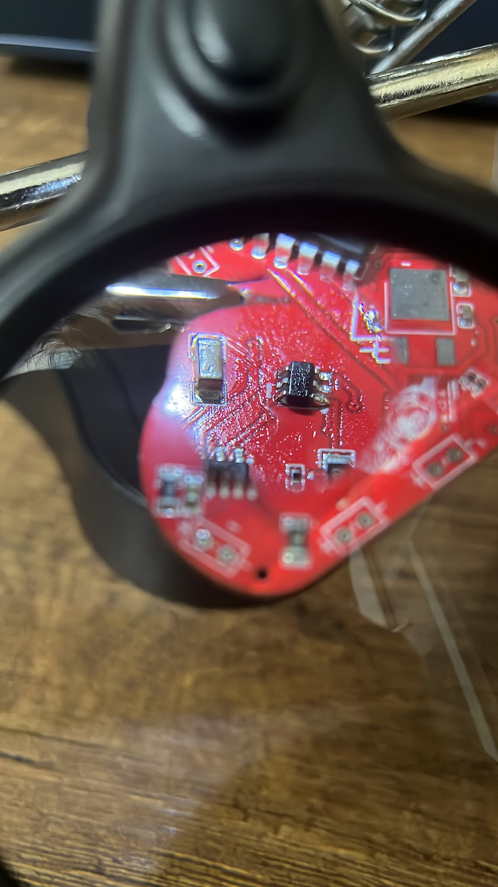
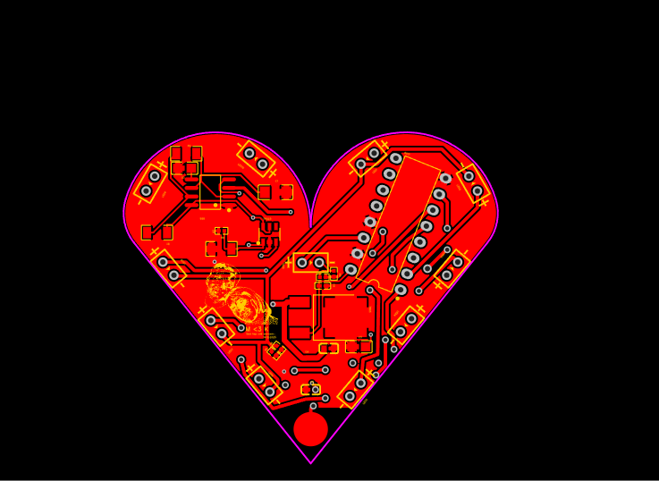

# Valentines day PCB

Dokunmatik kontrollü, kalp biçimli LED kartı. EasyEDA Standard ile Ocak–Şubat 2025 döneminde tasarladığım ve JLCPCB üzerinden ürettirdiğim kişisel elektronik projem.

*Atölyede, LED’leri monte edilmiş fiziksel kart. Video karesinden alınmıştır.*

## Fotoğraflar ve videolar

| Görüntü | İçerik |
| --- | --- |
| [LED sıralaması](led-sequence.mp4) | Çalışan kartın yakın plan videosu, yaklaşık 8 saniye |
| [LED montajından sonra](assembled-board.mp4) | Kartın atölyedeki görünümü, yaklaşık 8,5 saniye |
| [Montaj detayı](assembly-detail.mp4) | Kartın ve LED montajının yakın plan incelemesi |
| [SMD incelemesi](smd-inspection.mp4) | Büyüteç altında SMD bileşenler |

Videolar MP4 biçimindedir. Sesleri kaldırılmıştır; LED sıralaması videosu PCB’ye odaklanan yakın bir kadrajla kısaltılmıştır. Kaynak dosyalar değiştirilmemiştir. Tarayıcıda oynatmak için [portfolyodaki medya galerisini](https://korayakdogan.me/#pcb-medya) kullanabilirsin.

### Montaj aşamaları

*LED montajı öncesindeki kart.*

*SMD bileşenlerin montajı sırasında yakın plan.*

### PCB yerleşimi

*EasyEDA kaynak dosyasından alınmış üst katman yerleşimi.*

## Devre yapısı

Kartta TTP223-BA6 kapasitif dokunmatik sensörü, NE555 zamanlayıcısı, CD4017CN sayacı ve 7805 regülatörü bulunuyor. Mikrodenetleyici veya firmware kullanmıyor.

- **Besleme:** Pil girişi `+BATT` hattına, 7805 çıkışı `VCC` hattına bağlı. Projede 9 V pil ve 5 V regülasyon kullandım.
- **Dokunmatik kontrol:** TTP223’ün 1 numaralı çıkışı ile NE555’in 4 numaralı RESET girişi aynı `I/O` hattında. Dokunma elektrodu `TP` hattına bağlı.
- **Zamanlama ve LED sıralaması:** NE555’in 3 numaralı çıkışı, CD4017’nin 14 numaralı saat girişine `555-3` hattıyla bağlı. CD4017’nin on sayma çıkışı LED1–LED10’a gidiyor. `555L` adlı ayrı bir LED de zamanlayıcı çıkışına bağlı.

Bu bağlantılar depodaki PCB kaynağından okunabilir. Bileşenlerin pin işlevleri için [NE555](https://www.ti.com/product/NE555), [CD4017B](https://www.ti.com/product/CD4017B) ve [Tontek dokunmatik sensör ailesi](https://www.tontek.com.tw/product/product2?idx=243&lang=) üretici kaynaklarına bakılabilir; BOM’daki üretici ve parça kodları ayrıca dikkate alınmalıdır.

## Tasarımda kullanılan bileşenler

| Grup | Adet | Şemadaki tanım |
| --- | ---: | --- |
| Dokunmatik sensör | 1 | TTP223-BA6, SOT-23-6 |
| Zamanlayıcı | 1 | NE555, SOIC-8 |
| Sayaç | 1 | CD4017CN, PDIP-16 |
| Regülatör | 1 | 7805, TO-252 |
| LED | 11 | LED1–LED10 ve 555L |
| Direnç | 8 | 3 × 10 kΩ, 4 × 330 Ω, 1 × 120 Ω |
| Kondansatör | 6 | 10 µF, 10 nF, 330 nF, 30 pF, 2 × 100 nF |

[bom.csv](bom.csv), şemadaki 29 bileşeni referans kodları, değerleri, kılıfları ve tedarikçi kodlarıyla listeler. Bu liste tasarım BOM’udur. Montajda kullanılan muadil parçaları tanımlayan bir liste değildir: örneğin tedarik geçmişindeki LM7805MP/NOPB ile tasarımın TO-252 7805 ayak izi aynı kılıf bilgisine sahip değildir.

## Dosyalar

| Dosya | İçerik |
| --- | --- |
| [schematic.json](schematic.json) | EasyEDA Standard şema projesi, `Sheet_1` |
| [pcb.json](pcb.json) | Düzenlenebilir PCB yerleşimi |
| [bom.csv](bom.csv) | Şemadan çıkarılmış tasarım BOM’u |
| [pcb-layout.png](pcb-layout.png) | Üst katman, baskı ve kart sınırı görünümü |

JSON dosyaları EasyEDA Standard’ın **Dosya → Aç → EasyEDA** akışıyla açılabilir. Arayüz diline göre menü adları değişebilir. Düzenleme ve yeniden üretim için kaynak dosyaları kullanın; PNG üretim dosyası değildir.

## Proje geçmişi

Şema antetinde 31 Ocak 2025 tarihi ve 1.0 revizyonu bulunuyor. İlk üretimde 5 PCB sipariş ettim; kartları Şubat 2025’te elle dizip lehimledim.

Buradaki dosyalar EasyEDA hesabımdaki mevcut tasarımın 16 Ekim 2026 tarihli dışa aktarımıdır. İlk üretime gönderilen Gerber arşivinin birebir kopyası olarak sunulmamaktadır.

## Kapsam

Bu depo, kişisel projenin tasarım arşividir. Yeniden üretim öncesinde seçilen parçaların ayak izleri, LED akımı, besleme ve tasarım kuralları kontrol edilmelidir.

**Tasarım:** Koray Akdoğan · [Portfolyo](https://korayakdogan.me/) · [GitHub](https://github.com/Omrndr)
