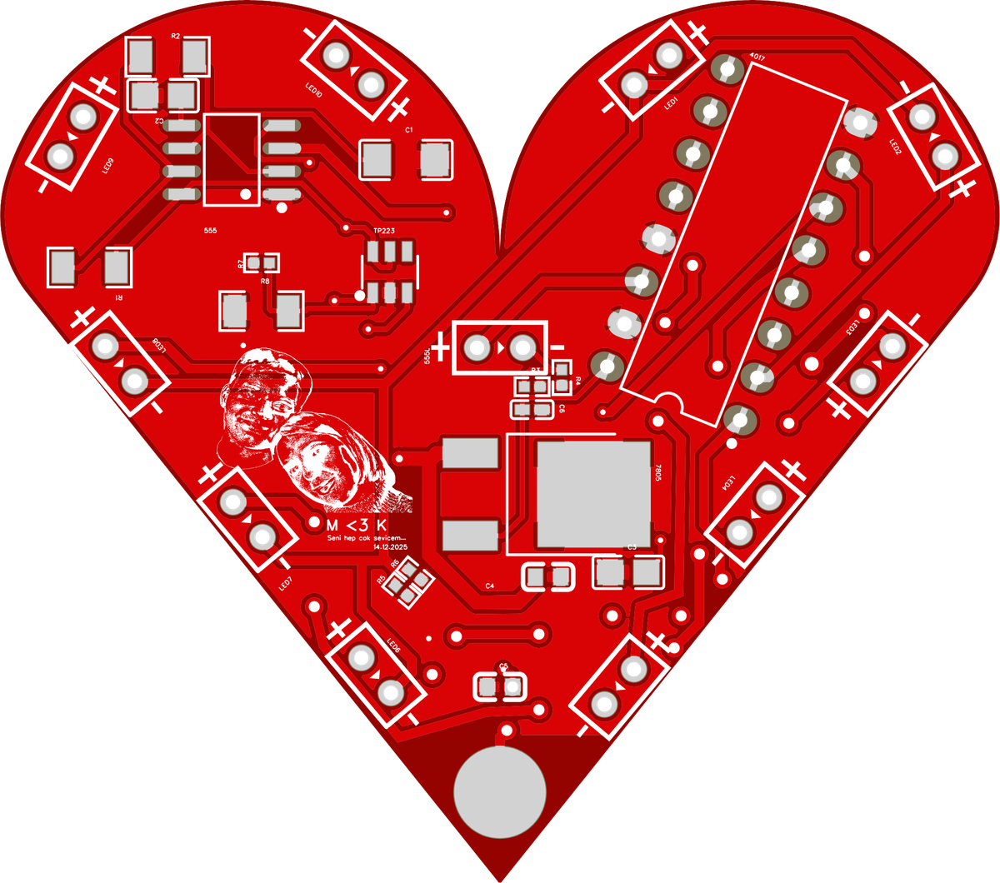
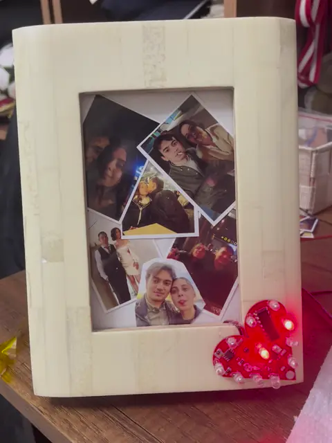
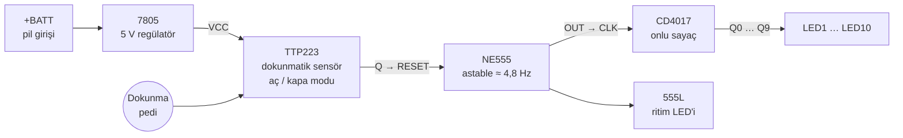
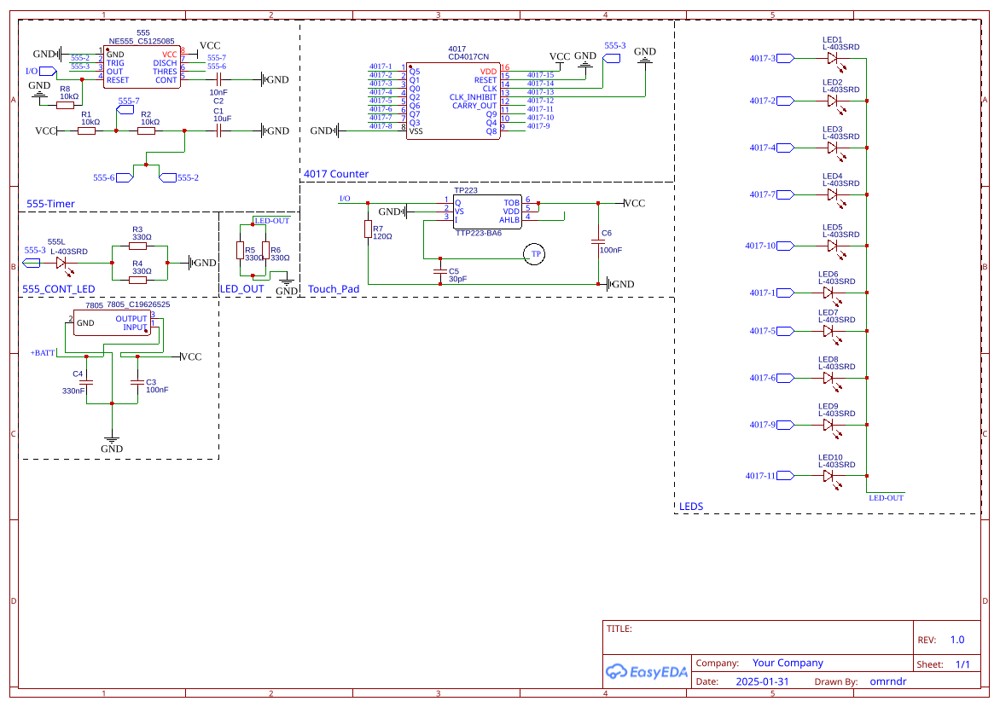
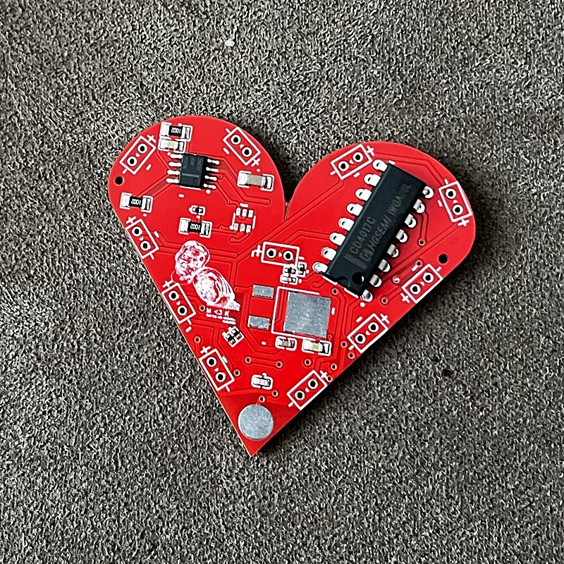
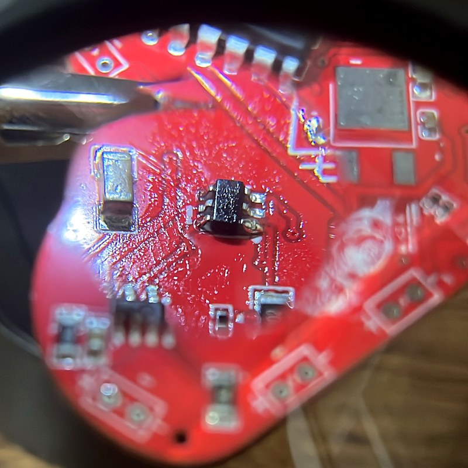
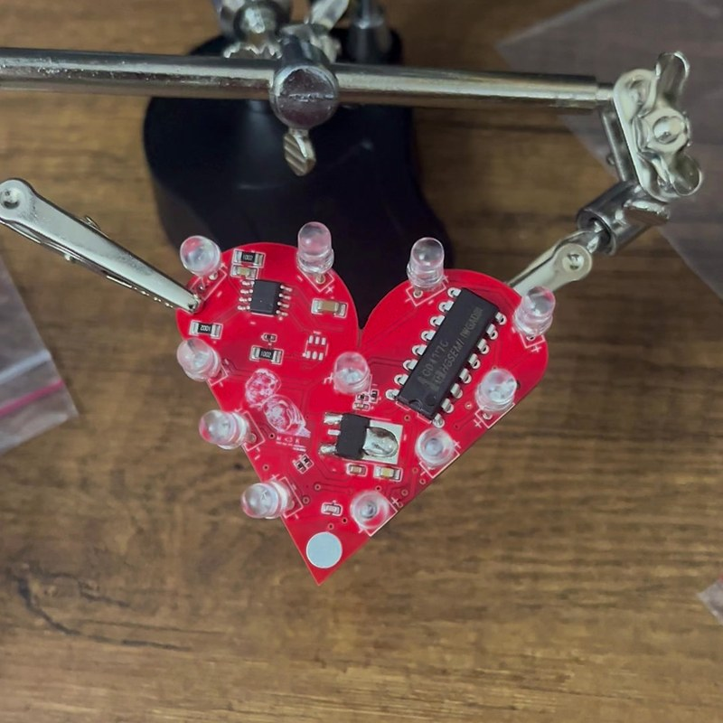

<div align="center">

# Valentine's Day PCB

**Dokunmatik kontrollü, kalp biçimli LED kartı**

Kalbin ucundaki pede dokununca on LED sırayla dönmeye başlar, tekrar dokununca durur.<br>
Mikrodenetleyici ya da yazılım yok: yalnızca NE555, CD4017 ve TTP223.


<table>
  <tr>
    <td align="center" width="50%"></td>
    <td align="center" width="50%"></td>
  </tr>
  <tr>
    <td align="center"><sub>Tasarım · EasyEDA üst yüz</sub></td>
    <td align="center"><sub>Çalışırken · <a href="videos/demo.mp4">tam videoyu aç</a></sub></td>
  </tr>
</table>

</div>

## Nasıl çalışır



1. **Besleme:** `+BATT` girişine gelen gerilimi 7805 regülatörü 5 V'a (`VCC`) düşürür. C4 (330 nF) girişte, C3 (100 nF) çıkışta.
2. **Dokunma:** Kalbin alt ucundaki yuvarlak ped TTP223'ün sensör girişine bağlıdır. TOG pini `VCC`'ye bağlı olduğu için sensör anahtar gibi davranır: her dokunuşta çıkış durum değiştirir.
3. **Zamanlama:** TTP223 çıkışı NE555'in RESET pinine gider. Çıkış yüksekken 555 astable modda salınır. R1 = R2 = 10 kΩ ve C1 = 10 µF ile frekans yaklaşık `1,44 / ((R1 + 2·R2)·C1) ≈ 4,8 Hz` olur.
4. **Sıralama:** Her saat darbesi CD4017'yi bir adım ilerletir ve Q0…Q9 çıkışları LED1…LED10'u sırayla yakar. Tam tur yaklaşık 2 saniye sürer. LED katotları ortak `LED-OUT` hattından paralel R5 ve R6 (330 Ω) üzerinden toprağa gider.

## Şema

[](images/schematic.svg)

<sub>Yazdırılabilir sürüm: [hardware/schematic.pdf](hardware/schematic.pdf) · Düzenlenebilir kaynak: [hardware/easyeda](hardware/easyeda)</sub>

## PCB

<table>
  <tr>
    <td align="center" width="50%"></td>
    <td align="center" width="50%"></td>
  </tr>
  <tr>
    <td align="center"><sub>Üst yüz: SMD parçalar, CD4017 ve LED'ler</sub></td>
    <td align="center"><sub>Alt yüz: yalnızca yollar ve THT lehim noktaları</sub></td>
  </tr>
</table>

| Özellik | Değer |
| --- | --- |
| Boyut | 55,38 × 49 mm |
| Katman | 2 |
| Parça sayısı | 29 (11 LED, 4 entegre, 8 direnç, 6 kondansatör) |
| Montaj | SMD dirençler, kondansatörler, NE555, TTP223 ve 7805; THT CD4017 ve LED'ler |

## Gerçek kart

<table>
  <tr>
    <td align="center" width="33%"></td>
    <td align="center" width="33%"></td>
    <td align="center" width="33%"><a href="videos/assembly.mp4"></a></td>
  </tr>
  <tr>
    <td align="center"><sub>SMD montajı bitti, LED'ler bekliyor</sub></td>
    <td align="center"><sub>Büyüteç altında TTP223</sub></td>
    <td align="center"><sub>LED'ler takıldı · <a href="videos/assembly.mp4">montaj videosu</a></sub></td>
  </tr>
</table>

## Malzeme listesi

| Referans | Adet | Değer | Kılıf | LCSC |
| --- | ---: | --- | --- | --- |
| 555 | 1 | NE555 | SOIC-8 | [C5125085](https://www.lcsc.com/search?q=C5125085) |
| 4017 | 1 | CD4017CN | PDIP-16 | [C20613262](https://www.lcsc.com/search?q=C20613262) |
| TP223 | 1 | TTP223-BA6 | SOT-23-6 | [C80757](https://www.lcsc.com/search?q=C80757) |
| 7805 | 1 | 7805 | TO-252-2 | [C19626525](https://www.lcsc.com/search?q=C19626525) |
| LED1–LED10, 555L | 11 | L-403SRD kırmızı LED | THT | [C2917801](https://www.lcsc.com/search?q=C2917801) |
| R1, R2, R8 | 3 | 10 kΩ | 1206 | [C17902](https://www.lcsc.com/search?q=C17902) |
| R3–R6 | 4 | 330 Ω | 0402 | [C25104](https://www.lcsc.com/search?q=C25104) |
| R7 | 1 | 120 Ω | 0402 | [C25079](https://www.lcsc.com/search?q=C25079) |
| C1 | 1 | 10 µF | 1206 | [C13585](https://www.lcsc.com/search?q=C13585) |
| C2 | 1 | 10 nF | 0805 | [C1710](https://www.lcsc.com/search?q=C1710) |
| C3 | 1 | 100 nF | 0805 | [C28233](https://www.lcsc.com/search?q=C28233) |
| C4 | 1 | 330 nF | 0603 | [C1615](https://www.lcsc.com/search?q=C1615) |
| C5 | 1 | 30 pF | 0603 | [C1658](https://www.lcsc.com/search?q=C1658) |
| C6 | 1 | 100 nF | 0402 | [C1525](https://www.lcsc.com/search?q=C1525) |

CSV olarak: [hardware/bom.csv](hardware/bom.csv)

## Kendin üret

1. [hardware/gerber/Gerber_Valentines-day.zip](hardware/gerber/Gerber_Valentines-day.zip) dosyasını PCB üreticisine yükle. Kartın kırmızı lehim maskeli sürümü yukarıdaki fotoğraflarda.
2. Parçaları [malzeme listesine](#malzeme-listesi) göre sipariş et.
3. Önce SMD parçaları, sonra CD4017'yi ve LED'leri lehimle. LED'lerin `+` işaretli pedi anottur.
4. `+BATT` girişine 7805'in çalışabileceği bir gerilim ver (örneğin 9 V pil) ve kalbin ucundaki pede dokun.

Tasarımı değiştirmek için `hardware/easyeda` içindeki JSON dosyalarını EasyEDA Standard'da **Dosya → Aç → EasyEDA** ile açabilirsin.

## Dosyalar

```
.
├── hardware/
│   ├── easyeda/        EasyEDA Standard kaynakları: şema ve PCB (JSON)
│   ├── gerber/         Üretim dosyaları (Gerber + delik dosyaları, ZIP)
│   ├── bom.csv         Malzeme listesi, LCSC kodlarıyla
│   └── schematic.pdf   Yazdırılabilir şema
├── images/             README görselleri
└── videos/             Montaj ve çalışma videoları
```

## Geçmiş

- **Ocak–Şubat 2025:** Şema ve PCB tasarımı (şema revizyonu 1.0, 31 Ocak 2025).
- **Şubat 2025:** Kartlar üretildi, elle lehimlendi ve bir fotoğraf çerçevesinin köşesine yerleştirildi.
- **Ekim 2026:** Gerber, şema ve PCB görselleri EasyEDA'daki güncel tasarımdan yeniden dışa aktarıldı. Bu dosyalar ilk siparişte kullanılan arşivin birebir kopyası değildir.

<div align="center">
<sub>Tasarım: <a href="https://github.com/Omrndr">Koray Akdoğan</a> · <a href="https://korayakdogan.me/">korayakdogan.me</a></sub>
</div>
